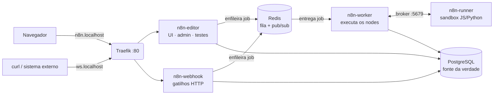

# n8n self-hosted em modo fila com task-runners

> Como subir o n8n do jeito que se roda em **produção**, separado em papéis
> (editor, worker, webhook e task-runner) sobre **PostgreSQL** e **Redis**, com Docker.
> Cada serviço sobe por um script próprio e comentado, para que dê para entender
> **o porquê** de cada peça e não só copiar um `docker-compose`.

O n8n "de tutorial" roda num processo só com SQLite. Funciona para testar, mas um único
workflow pesado ou em loop derruba tudo, inclusive o editor. Este repositório mostra a
arquitetura que resolve isso e documenta os problemas que encontrei montando o stack.

---

## Arquitetura



| Container | Imagem | Papel | Exposto? |
|-----------|--------|-------|----------|
| `traefik-app` | `traefik` | Proxy reverso; roteia pelo domínio (header `Host`) | porta 80 |
| `n8n-pgsql` | `pgvector/pgvector:pg18` | Workflows, credentials cifradas, execuções, usuários | não |
| `n8n-redis` | `redis` | Fila de jobs (Bull) + pub/sub entre processos | não |
| `n8n-editor` | `n8nio/n8n` | UI, administração, edição e testes | `n8n.localhost` |
| `n8n-webhook` | `n8nio/n8n` `webhook` | Recebe gatilhos HTTP de produção e enfileira | `ws.localhost` |
| `n8n-worker` | `n8nio/n8n` `worker` | Consome a fila e executa o workflow | não |
| `n8n-runner` | `n8nio/runners` | Executa o código do **Code node** isolado | não |

> A mesma imagem `n8nio/n8n` vira editor, worker ou webhook: o que muda é o **comando** no final.

---

## Por que essa arquitetura?

| Modo | Como funciona | Quando usar |
|------|---------------|-------------|
| **1. Simples** | um processo + SQLite | aprender, testar. Não serve para produção |
| **2. Fila** | editor + worker + webhook, com Redis + Postgres | produção; permite escala horizontal (mais workers) |
| **3. Fila + task-runners** ← **este repo** | igual ao 2, mas o código do usuário (Code node) roda num sandbox separado | produção mais resiliente |

**O problema que o modo 3 resolve:** no modo 2, um Code node com bug (loop infinito, lista
gigante) trava o worker. Outro worker pega o mesmo job e trava também: é um **efeito
cascata**. Com o task-runner, o código roda num processo à parte. Se ele travar, falha só
aquele node e o worker continua de pé.

Detalhes em [docs/01-arquitetura.md](docs/01-arquitetura.md).

---

## Quickstart

Pré-requisitos: Linux (ou WSL2), Docker 24+, `curl`, `openssl`, porta 80 livre.

```bash
git clone https://github.com/<seu-usuario>/n8n-queue-mode-task-runners.git
cd n8n-queue-mode-task-runners

cp .env.example .env
# gere um valor para cada segredo e cole no .env:
openssl rand -hex 32   # POSTGRES_PASSWORD
openssl rand -hex 32   # N8N_ENCRYPTION_KEY
openssl rand -hex 32   # N8N_RUNNERS_AUTH_TOKEN

./scripts/up.sh        # sobe tudo na ordem, esperando cada dependência
./scripts/status.sh    # confere containers e /healthz
```

Abra **http://n8n.localhost**, crie o usuário owner e pronto.
Para desligar: `./scripts/down.sh` (remove os containers e **mantém os dados**).

> 📚 Para aprender, **não use o `up.sh`**: siga o
> [passo a passo](docs/02-passo-a-passo.md) rodando um script por vez e verificando cada serviço.

---

## Estrutura

```
.
├── .env.example            # variáveis (versões, domínios, segredos placeholder)
├── scripts/
│   ├── _common.sh          # carrega .env, valida segredos, helpers
│   ├── run-00-storage.sh   # pastas de dados persistentes
│   ├── run-01-network.sh   # rede bridge dedicada (DNS interno)
│   ├── run-02-traefik.sh   # proxy reverso
│   ├── run-03-postgresql.sh
│   ├── run-04-redis.sh
│   ├── run-05-n8n-editor.sh
│   ├── run-06-worker.sh
│   ├── run-07-runner.sh
│   ├── run-08-webhook.sh
│   ├── up.sh · down.sh · status.sh
├── docs/                   # o tutorial (ver abaixo)
├── workflows/              # workflows de exemplo exportados (sem segredos)
└── estudos/                # minhas notas de estudo de n8n, fase a fase
```

## Documentação

1. [Arquitetura](docs/01-arquitetura.md): os 3 modos, o caminho de uma execução e quem guarda qual segredo
2. [Passo a passo](docs/02-passo-a-passo.md): subindo serviço por serviço e verificando cada um
3. [Variáveis de ambiente](docs/03-variaveis-de-ambiente.md): o que cada `-e` faz e em qual serviço
4. [Operação](docs/04-operacao.md): logs, backup, atualização de versão, escalar workers
5. [Troubleshooting](docs/05-troubleshooting.md): erros reais que encontrei e como resolvi
6. [Perguntas de entrevista](docs/06-perguntas-de-entrevista.md): o que este setup ensina, em perguntas e respostas

---

## Decisões de projeto

- **Scripts `docker run` em vez de `docker-compose`:** é uma escolha didática. Cada serviço fica
  isolado num arquivo comentado, e dá para subir, quebrar e recriar uma peça de cada vez.
  Num ambiente real, o próximo passo natural é um `compose.yml` ou Kubernetes.
- **Versões pinadas** no `.env`: `latest` faz o mesmo comando subir coisas diferentes em dias
  diferentes. Editor, worker, webhook e runner compartilham `N8N_VERSION`.
- **Menor privilégio:** Postgres e Redis não publicam porta. O runner não recebe senha do banco,
  acesso ao Redis nem a `N8N_ENCRYPTION_KEY`, porque é o componente que roda o código menos confiável.
- **Containers `--read-only` + `tmpfs`:** o sistema de arquivos da imagem é imutável; só os
  volumes de dados e `/tmp` aceitam escrita.
- **Limites de CPU/memória** em todo container: um serviço descontrolado não consome a máquina toda.
- **Idempotência:** todo script remove o container antes de recriá-lo. Rodar uma vez ou dez
  vezes dá o mesmo resultado.

## Limitações conhecidas (e o que eu faria em produção)

| Aqui (local) | Em produção |
|--------------|-------------|
| HTTP puro (`*.localhost`) | HTTPS via Let's Encrypt no Traefik, `N8N_SECURE_COOKIE=true` |
| Redis sem senha (isolado só pela rede) | `requirepass` + `QUEUE_BULL_REDIS_PASSWORD` |
| Dashboard do Traefik sem auth (só em 127.0.0.1) | dashboard desligado ou atrás de autenticação |
| Um worker + um runner | ≥ 2 workers e ≥ 4 runners, ver [operação](docs/04-operacao.md#escalar-workers) |
| Backup manual | `pg_dump` agendado + cópia da `N8N_ENCRYPTION_KEY` em cofre de segredos |
| Sem manutenção do banco | `VACUUM` mensal (o n8n não faz) + `EXECUTIONS_DATA_MAX_AGE` para podar execuções antigas |
| Logs nos containers | coleta centralizada + `/metrics` (Prometheus) |

## Roadmap do repositório

Onde este projeto quer chegar, tendo como referência o guia que inspirou a arquitetura:

- [x] Stack em modo fila + task-runner externo, serviço por serviço, documentado
- [x] Segredos fora dos arquivos versionados, versões pinadas, menor privilégio
- [ ] `compose.yml` standalone equivalente aos scripts (`depends_on` com `service_healthy`)
- [ ] Variante de produção com domínio real + HTTPS (Let's Encrypt, redirect 80→443)
- [ ] Escala: 2 workers + 4 runners; depois uma stack Docker Swarm com réplicas
- [ ] Tuning: `DB_POSTGRESDB_POOL_SIZE`, `EXECUTIONS_DATA_MAX_AGE`, `QUEUE_HEALTH_CHECK_ACTIVE`
- [ ] Criação do usuário owner automatizada via API (`/rest/owner/setup`)
- [ ] Rotina de backup + `VACUUM` agendada

## Segurança

- O `.env` real é gitignored; só o `.env.example` (placeholders) é versionado.
- Os workflows em `workflows/` referenciam credentials **por ID**, nunca pelo segredo.
  Mesmo assim, audite todo `.json` antes de commitar: um token colado num campo livre vaza.

---

## Créditos

Arquitetura baseada no [guia de instalação do n8n v2 de Patrick Brandão](https://blog.patrickbrandao.com/n8n-v2-guia-de-instalacao/),
adaptada para ambiente local, com versões pinadas, validação de segredos e documentação didática.

Feito por **Eliel Delfino** enquanto estudava n8n para trabalhar com automação.
